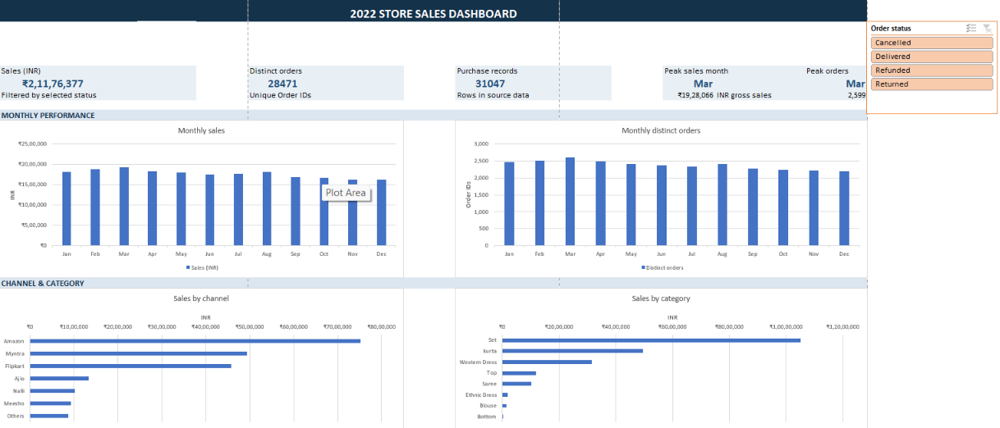
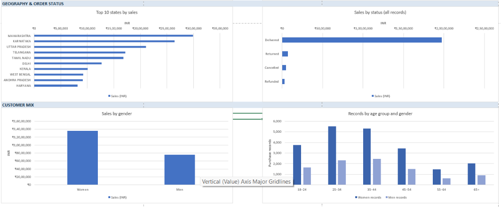

# BigBasket Store Sales Dashboard (2022)

The Excel workbook contains the dashboard and its source data. The screenshots below show the existing Dashboard worksheet in Excel.

## Dashboard screenshots

## Key insights

- Total sales were INR 2,11,76,377 across 31,047 purchase records and 28,471 distinct orders.
- Women contributed 64.0% of sales.
- Amazon, Myntra, and Flipkart together contributed 80.4% of sales.
- Maharashtra, Karnataka, and Uttar Pradesh together contributed 36.6% of sales.
- March had the highest sales (INR 19,28,066) and the most orders (2,599).
- Set was the top category at 49.6% of sales.
- Delivered orders accounted for 93.1% of sales.

## Workbook privacy

The public workbook preserves the dashboard charts while blanking customer IDs, shipping cities, and postal codes. Original order numbers are replaced consistently with synthetic values.
